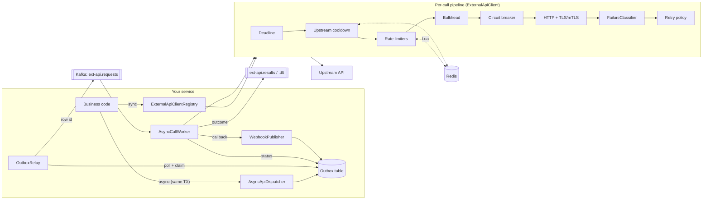
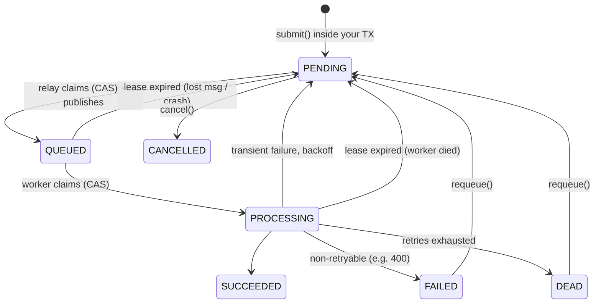

# external-api-client

[](https://github.com/viren97/external-api-client/actions/workflows/ci.yml)


A Spring Boot starter for calling third-party HTTP APIs safely: payment providers, banks, KYC vendors, partner systems.

Add the dependency, describe each upstream in `application.yml`, and inject a client. Every call then goes through retries that respect idempotency, a circuit breaker, a rate limiter (local or shared through Redis), a bulkhead and a total deadline. TLS and mTLS come from configuration, and failures arrive as one sealed exception type you can match on exhaustively. Calls that should not block a request can go through a **transactional outbox**, with Kafka or a local thread pool carrying the work and signed **webhooks** reporting the outcome.

```kotlin
val account = clients.client("payments").get<Account>("/accounts/42", operation = "get-account")
```

---

## Table of contents

- [Why](#why)
- [Features](#features)
- [Architecture](#architecture)
- [Quick start](#quick-start)
- [Making calls](#making-calls)
- [Failure handling](#failure-handling)
- [Retries and idempotency](#retries-and-idempotency)
- [Circuit breaker](#circuit-breaker)
- [Rate limiting](#rate-limiting)
- [TLS and mTLS](#tls-and-mtls)
- [Authentication](#authentication)
- [Async calls: outbox + Kafka](#async-calls-outbox--kafka)
- [Webhooks](#webhooks)
- [Observability](#observability)
- [Extension points](#extension-points)
- [Configuration reference](#configuration-reference)
- [Building and testing](#building-and-testing)
- [Design decisions](#design-decisions)
- [Limitations and roadmap](#limitations-and-roadmap)

---

## Why

Most outbound HTTP code starts as `restTemplate.postForObject(...)` and collects edge cases one incident at a time:

| Incident | Root cause | What this module does |
|---|---|---|
| Customer charged twice | A POST was retried after a read timeout | POST/PATCH are retried only with an idempotency key. A read timeout on an unsafe call is reported as "outcome unknown" and never retried. |
| Every request thread stuck for 30 s | The provider was down and each call waited for its own timeout | A circuit breaker fails fast while the upstream is unhealthy, and a bulkhead caps concurrent calls. |
| Account suspended for quota abuse | 20 pods each enforced "100 rps" on their own | A Redis token bucket or sliding window is shared by all instances. A 429 `Retry-After` pauses every instance. |
| Event lost on deploy | The call happened after the DB commit and the pod died in between | The transactional outbox stores the call in the same transaction as the business data. |
| "Handshake failed" at 3 a.m. | A wrong trust store was found only on the first request | TLS material is validated at startup, with an error that names the client and the setting. |

## Features

**REST client**
- Named clients, each with its own Apache HttpClient 5 connection pool, so one slow provider cannot starve the others
- Separate connect, response and pool-acquire timeouts, plus a **total deadline** that covers all retries
- JSON (Jackson + Kotlin), form-encoded, raw `String` and `ByteArray` bodies; path templates; a response size cap
- Correlation id propagated from MDC (`correlationId` / `traceId`)
- Request and response logging with secrets masked in headers, query strings and JSON fields
- Clients can be registered at runtime (for example per-tenant endpoints)

**Resilience**
- Exponential backoff with jitter; `Retry-After` (seconds or HTTP date) is honoured
- Idempotency-aware retries, with optional auto-generated `Idempotency-Key`
- Count-based **circuit breaker** with failure-rate and slow-call-rate thresholds and half-open probing, per client or per operation
- **Bulkhead** that caps concurrent calls
- Transparent token refresh and a single retry on `401`

**Rate limiting**
- Token bucket or sliding window
- LOCAL (in-JVM) or **REDIS** (atomic Lua using Redis server time, Redis Cluster-safe keys)
- Per-client limit plus per-operation limits
- Fail modes for a Redis outage: `OPEN`, `CLOSED` or `LOCAL_FALLBACK`
- **Adaptive cooldown**: an upstream 429/503 with `Retry-After` pauses every caller and every instance

**Security**
- TLS modes `DEFAULT`, `TLS` (private CA), `MTLS`, and `INSECURE_TRUST_ALL` for development only
- Key and trust material from PKCS12/JKS, PEM files, or a Spring Boot **SSL bundle**
- SPKI **certificate pinning**, protocol and cipher allow-lists, a hostname-verification switch
- Startup validation and expiry warnings for client certificates
- Auth: Bearer, API key, Basic, OAuth2 client credentials (sent over the client's own mTLS), or your own provider

**Async processing**
- **Transactional outbox** on plain JDBC (works with JPA, jOOQ or JDBC); a call is scheduled only if your transaction commits
- **Kafka** transport (multi-instance) or **IN_PROCESS** transport (no broker)
- Retries with backoff for hours, dead-lettering, deduplication keys, scheduled calls (`notBefore`), cancel and requeue
- Outcomes published to a result topic or DLT, to in-process listeners, and to **callback webhooks**
- Crash-safe: work whose lease expires is recovered, and duplicate Kafka deliveries do nothing

**Webhooks**
- Outbound: HMAC-SHA256 signed when sent (so retries carry a fresh timestamp), delivered through the outbox, one circuit breaker per subscriber host
- Inbound: signature, timestamp tolerance and **replay protection** (Redis or local), zero-downtime secret rotation, a handler registry

**Operations**
- Micrometer metrics (calls, attempts, retries, rejections, breaker state, async outcomes)
- Actuator health indicator showing each breaker's state and failure rates

## Architecture



**Order of protections.** Cheap local checks run before anything that holds a scarce resource. Cooldown and rate limiting run first. The bulkhead slot is taken next. A circuit-breaker permit is taken last, just before the network call, so a half-open probe slot is never spent on a call that was going to be throttled anyway.

**Async lifecycle.** The database row is the source of truth. Kafka carries only "row X is ready", so a lost or duplicated message cannot lose a call or run it twice.



## Quick start

### 1. Add the dependency

```kotlin
dependencies {
    implementation("dev.viren:external-api-client:0.1.0-SNAPSHOT")

    // Optional: add only the features you use
    implementation("org.springframework.boot:spring-boot-starter-data-redis") // distributed rate limiting
    implementation("org.springframework.kafka:spring-kafka")                  // async over Kafka
    implementation("org.springframework.boot:spring-boot-starter-jdbc")       // outbox
    implementation("org.springframework.boot:spring-boot-starter-actuator")   // health + metrics
}
```

Until it is published to a repository, run `./gradlew publishToMavenLocal` (with `maven-publish` applied) or use a composite build (`includeBuild("../external-api-client")`).

### 2. Describe the upstream

```yaml
ext-api:
  clients:
    payments:
      base-url: https://api.psp.example.com/v2
      timeouts: { connect: 2s, response: 8s, total: 20s }
      tls:
        mode: MTLS
        key-store: { location: file:/etc/certs/client.p12, password: ${PSP_KEYSTORE_PASSWORD} }
        trust-store: { location: classpath:certs/psp-ca.p12, password: ${PSP_TRUST_PASSWORD} }
      auth:
        type: OAUTH2_CLIENT_CREDENTIALS
        token-url: https://auth.psp.example.com/oauth/token
        client-id: ${PSP_CLIENT_ID}
        client-secret: ${PSP_CLIENT_SECRET}
      retry: { max-attempts: 3, auto-idempotency-key: true }   # PSP dedupes on Idempotency-Key
      circuit-breaker: { failure-rate-threshold: 50, open-duration: 30s }
      rate-limit:
        enabled: true
        backend: REDIS
        limit: 50
        window: 1s
        operations:
          create-payout: { limit: 5, window: 1s }
```

### 3. Call it

```kotlin
@Service
class PaymentGateway(clients: ExternalApiClientRegistry) {
    private val psp = clients.client("payments")

    fun charge(orderId: String, amount: Money): Charge =
        psp.call<Charge>(
            ApiRequest.post("/charges", ChargeRequest(amount), operation = "create-charge", idempotencyKey = "charge-$orderId"),
        ).requireBody()
}
```

## Making calls

```kotlin
// Typed GET with path template: the metric tag becomes "GET /accounts/{id}", not the raw id
client.call<Account>(ApiRequest.get("/accounts/{id}").withPathParam("id", accountId).withQuery("expand", "owner"))

// Full response: status, headers, attempts, duration, correlation id
val res: ApiResponse<Quote> = client.call(ApiRequest.get("/quotes/fx", operation = "fx-quote"))
res.header("X-Request-Id"); res.attempts; res.duration

// Per-call overrides
ApiRequest.get("/reports/big", operation = "report").copy(timeout = Duration.ofSeconds(60), maxAttempts = 1)

// Form body
ApiRequest(HttpMethod.POST, "/token", body = mapOf("grant_type" to "password"), contentType = ApiRequest.FORM)

// Fallback instead of exception
val rate = client.callOrElse(ApiRequest.get("/rates/USD")) { cachedRate("USD") }

// Java / non-reified
client.execute(request, Account::class.java)
client.execute(request, object : TypeReference<List<Account>>() {})
```

## Failure handling

Every failure is a subclass of the sealed `ExternalApiException`. Each one carries `kind`, `retryable`, `countsAsFailure` (for the circuit breaker), `status`, `responseBody`, `responseHeaders`, `retryAfter` and `attempts`.

| Exception | `kind` | Retried? | Trips breaker? | Typical cause |
|---|---|---|---|---|
| `ClientErrorException` | `CLIENT_ERROR` | only 408/425 | only 408 | 400, 404, 409, 422 |
| `UnauthorizedException` | `UNAUTHORIZED` | refresh once on 401 | no | expired or invalid credentials |
| `UpstreamRateLimitedException` | `UPSTREAM_RATE_LIMITED` | yes, after `Retry-After` | no | 429, or 503 with `Retry-After` |
| `ServerErrorException` | `SERVER_ERROR` | 502/503 always; 500/504 if safe to repeat | yes | provider fault |
| `ApiTimeoutException` | `CONNECT_TIMEOUT` | yes | yes | host unreachable |
| | `RESPONSE_TIMEOUT` | only if safe to repeat | yes | slow upstream; **outcome unknown** |
| | `POOL_TIMEOUT` | yes | no | local pool exhausted |
| `ConnectionFailedException` | `CONNECTION_FAILED` / `DNS_FAILURE` | refused/DNS: yes. Reset/no response: only if safe | yes | network |
| `TlsFailureException` | `TLS_FAILURE` | never | yes | trust, hostname, client cert, pin; the message includes a hint |
| `CircuitOpenException` | `CIRCUIT_OPEN` | no (fail fast), `retryAfter` set | — | breaker open |
| `RateLimitExceededException` | `RATE_LIMITED` | no, `retryAfter` set | — | local quota or upstream cooldown |
| `BulkheadFullException` | `BULKHEAD_FULL` | no | — | too many concurrent calls |
| `DeadlineExceededException` | `DEADLINE_EXCEEDED` | no | — | `timeouts.total` used up |
| `SerializationFailureException` | `SERIALIZATION` | no | no | body could not be encoded or decoded (raw body attached) |
| `ResponseTooLargeException` | `RESPONSE_TOO_LARGE` | no | no | `max-response-bytes` exceeded |

```kotlin
try {
    gateway.charge(orderId, amount)
} catch (e: ExternalApiException) {
    when (e) {
        is ClientErrorException -> rejectOrder(e.status, e.responseBody)
        is ApiTimeoutException  -> if (e.kind == FailureKind.RESPONSE_TIMEOUT) scheduleReconciliation(orderId) else retryLater()
        is CircuitOpenException, is RateLimitExceededException -> retryLater(e.retryAfter)
        else -> throw e
    }
}
```

"Safe to repeat" means the method is idempotent (GET, PUT, DELETE, ...), **or** the request has an idempotency key, **or** `retry.retry-non-idempotent=true`.

## Retries and idempotency

- `retry.max-attempts` counts the first attempt (3 means at most 2 retries).
- Backoff: `initial-backoff × multiplier^(n-1)`, capped at `max-backoff`, with `jitter` (0 means none, 1 means full jitter).
- `Retry-After` replaces the computed backoff. A value larger than `max-retry-after` fails the call instead of sleeping.
- No retry starts if it would end after `timeouts.total`.
- **POST/PATCH are not retried by default.** Pass `idempotencyKey = ...` (sent as `Idempotency-Key`). If the upstream dedupes on that header (Stripe, Adyen and others do), set `auto-idempotency-key: true` to have a key generated for every unsafe call.
- Async calls keep the same idempotency key on every redelivery: it is fixed when the call is submitted (the dedupe key, or else the outbox id).

## Circuit breaker

```
CLOSED --(failure rate or slow rate >= threshold over >= minimum-calls)--> OPEN
OPEN   --(open-duration elapsed)--> HALF_OPEN (allows half-open-permitted-calls probes)
HALF_OPEN --(probe failure rate < threshold)--> CLOSED
HALF_OPEN --(probe failure rate >= threshold)--> OPEN
```

- What counts as a failure: 5xx, timeouts, connection and TLS errors, 408. Not counted: other 4xx (the caller's fault), 429 (handled by the cooldown), and local rejections.
- `per-operation: true` keeps one breaker per operation, so a broken `/reports` endpoint does not block `/payments`. The webhook client uses one breaker per subscriber host.
- `CircuitBreakerRegistry` exposes `forceOpen()`, `reset()`, `metrics()` and state-change listeners, which are useful for admin endpoints and alerts.
- Health: `/actuator/health/extApi` reports each breaker. An open breaker reports `UNKNOWN`, not `DOWN`, so an outage at a third party does not make Kubernetes restart your pods.

## Rate limiting

```yaml
rate-limit:
  enabled: true
  backend: REDIS            # LOCAL | REDIS
  algorithm: TOKEN_BUCKET   # TOKEN_BUCKET (allows bursts) | SLIDING_WINDOW (strict)
  limit: 100
  window: 1s
  burst: 150                # bucket capacity, defaults to limit
  max-wait: 200ms           # block up to this long for a permit; 0 = fail fast
  fail-mode: LOCAL_FALLBACK # Redis down: OPEN | CLOSED | LOCAL_FALLBACK
  adaptive-cooldown: true
  operations:
    create-payout: { limit: 5, window: 1s }
```

- Each Redis check is a single Lua script, so it is atomic across instances. It reads the clock with `redis.call('TIME')`, so clock skew between application nodes does not matter. Keys look like `extapi:rl:{client}` (hash-tagged for Redis Cluster) and expire when idle.
- Per-operation limits are checked before the client-wide limit, so a rejected call does not use up a client-level permit.
- **Adaptive cooldown:** when the upstream answers 429 (or 503) with `Retry-After`, the client records a cooldown. Every caller on every instance (through Redis, when `backend: REDIS`) holds off for that long, instead of each one getting its own 429.

## TLS and mTLS

| Mode | Use for | Needs |
|---|---|---|
| `DEFAULT` | Public APIs over HTTPS, or plain HTTP | nothing (JVM trust store) |
| `TLS` | A server whose certificate is signed by a private or internal CA | `trust-store` **or** `trust-certificates-pem` |
| `MTLS` | Banks, PSPs, open banking, service mesh egress | `key-store` **or** `client-certificate-pem` + `client-private-key-pem`, plus trust if the CA is private |
| `INSECURE_TRUST_ALL` | Local development only (a warning is logged) | — |

```yaml
tls:
  mode: MTLS
  # Option A: key stores
  key-store: { location: file:/certs/client.p12, password: ${KS_PASS}, type: PKCS12 }
  key-alias: psp-prod            # when the store holds several client certs
  trust-store: { location: classpath:psp-ca.p12, password: ${TS_PASS} }
  # Option B: PEM files
  client-certificate-pem: file:/certs/client-chain.pem
  client-private-key-pem: file:/certs/client-key.pem   # unencrypted PKCS#8 ("BEGIN PRIVATE KEY")
  trust-certificates-pem: file:/certs/ca.pem
  # Option C: a Spring Boot SSL bundle (spring.ssl.bundle.*), which replaces A and B
  bundle: psp
  # Hardening
  protocols: [TLSv1.3, TLSv1.2]
  pinned-sha256: [ "base64-SPKI-sha256=" ]
```

- Misconfiguration fails **application startup** with an error that names the client, for example: `ext-api client 'payments': mode MTLS needs key-store.location or ...`.
- A client certificate that has expired fails startup. One that expires within 30 days logs a warning.
- Handshake failures include a hint: *server certificate not trusted*, *hostname does not match SAN*, *server rejected our client certificate*, *pin mismatch*.
- PKCS#1 keys (`BEGIN RSA PRIVATE KEY`) are rejected with the `openssl pkcs8` command that converts them.
- Get a pin with: `openssl x509 -in server.crt -pubkey -noout | openssl pkey -pubin -outform der | openssl dgst -sha256 -binary | base64`

## Authentication

| `auth.type` | Settings |
|---|---|
| `NONE` | — |
| `BEARER` | `token` |
| `API_KEY` | `api-key`, `api-key-header` (default `X-API-Key`) |
| `BASIC` | `username`, `password` |
| `OAUTH2_CLIENT_CREDENTIALS` | `token-url`, `client-id`, `client-secret`, `scope`, `audience`, `refresh-skew` |
| `CUSTOM` | `custom-bean`: name of your `AuthProvider` bean (HMAC signing, AWS SigV4, ...) |

OAuth tokens are cached until `expires_in − refresh-skew` and refreshed by one thread at a time. A `401` clears the token and the call is retried once, without using up a retry attempt. The token request goes through the client's own connection pool, so mTLS applies to the token endpoint as well.

## Async calls: outbox + Kafka

```yaml
ext-api:
  async:
    enabled: true
    transport: KAFKA          # or IN_PROCESS (no broker)
    request-topic: ext-api.requests
    result-topic: ext-api.results
    dead-letter-topic: ext-api.requests.dlt
    max-attempts: 8
    initial-backoff: 5s
    max-backoff: 1h
    lease: 60s                # must be longer than the slowest client's timeouts.total
spring.kafka.bootstrap-servers: localhost:9092
```

```kotlin
@Transactional
fun placeOrder(cmd: PlaceOrder): Order {
    val order = orders.save(Order.from(cmd))
    async.submit(
        "payments",
        ApiRequest.post("/charges", ChargeRequest(order.total), operation = "create-charge"),
        AsyncOptions(
            dedupeKey = "charge-${order.id}",                 // submitting twice returns the same id
            callbackUrl = "https://orders.internal/hooks/charges",
            callbackEvent = "charge.completed",
            notBefore = null,                                 // or Instant for scheduled calls
        ),
    )
    return order  // the call exists only if this transaction commits
}

@Component
class ChargeResults : AsyncResultListener {
    override fun onResult(result: AsyncCallResult) { /* update order: result.status, responseBody, errorKind */ }
}
```

**Guarantees**

- *At-least-once* towards the upstream. Use idempotency keys (fixed when the call is submitted) for effectively-once processing.
- Several instances coordinate through compare-and-set updates (`UPDATE ... WHERE status = ?`). This works on PostgreSQL, MySQL, H2, Oracle and SQL Server and needs no `SKIP LOCKED`.
- Local rejections (open circuit, rate limited, bulkhead full) are **deferred and retried**, not failed: async work can wait.
- A non-idempotent call that times out ends `FAILED` with `RESPONSE_TIMEOUT`, because its outcome is unknown. Reconcile it rather than resending blindly.
- The app's own Kafka serializers are never touched: the module builds its own String/String producer and consumer from `spring.kafka.*`, with `acks=all` and idempotence on.
- Operations: `async.status(id)`, `async.cancel(id)`, `async.requeue(id)`. Finished rows are purged after `retention` (default 7 days).
- Schema: created automatically (`initialize-schema: true`). For Flyway or Liquibase, copy [`db/ext-api-outbox.sql`](src/main/resources/db/ext-api-outbox.sql).

## Webhooks

**Signature scheme** (outbound and inbound use the same one):

```
X-Webhook-Id:        evt_123
X-Webhook-Timestamp: 1764151200            (unix seconds)
X-Webhook-Signature: v1=hex(HMAC_SHA256(secret, "evt_123.1764151200.<raw body>"))
```

### Sending

```kotlin
webhooks.publish(
    url = subscriber.url,
    eventType = "payout.paid",
    data = PayoutPaid(payout.id, payout.amount),
    dedupeKey = "payout-paid-${payout.id}",
)
```

Deliveries go through the outbox, so they survive restarts, are retried for hours (`webhooks.outbound.max-attempts`), and are only sent if your transaction commits. Each delivery is **signed when it is sent**, so a retry six hours later still passes the receiver's timestamp check. Each subscriber host has its own breaker. Provide a `WebhookSecretResolver` bean to use a different secret per subscriber.

### Receiving

```yaml
ext-api.webhooks.inbound:
  enabled: true
  path: /webhooks            # POST /webhooks/{source}
  tolerance: 5m
  sources:
    psp:
      secrets: [ ${PSP_WEBHOOK_SECRET_NEW}, ${PSP_WEBHOOK_SECRET_OLD} ]   # rotation without downtime
      signature-header: X-Webhook-Signature   # match the provider's names
```

```kotlin
@Component
class PspEvents : InboundWebhookHandler {
    override val source = "psp"
    override fun handle(webhook: InboundWebhook) { /* webhook.eventId, webhook.text */ }
}
```

| Response | Meaning |
|---|---|
| `202` | verified and handled |
| `200` | duplicate (already processed): acknowledged so the sender stops retrying |
| `400` | missing headers or timestamp outside the tolerance |
| `401` | bad signature |
| `404` | unknown source |
| `500` | your handler threw: the event is un-marked so the sender's retry is processed |
| `503` | replay store (Redis) unavailable: the sender should retry |

## Observability

**Metrics** (Micrometer, registered automatically when a `MeterRegistry` exists)

| Metric | Tags |
|---|---|
| `ext_api.client.calls` (timer, histogram) | `client`, `operation`, `method`, `outcome` (`success` or a FailureKind), `status` |
| `ext_api.client.attempts` (summary) | `client`, `operation` |
| `ext_api.client.retries` | `client`, `operation`, `reason` |
| `ext_api.client.rejected` | `client`, `operation`, `reason` (`CIRCUIT_OPEN`, `RATE_LIMITED`, `BULKHEAD_FULL`) |
| `ext_api.circuit.state` (gauge) | `breaker`: 0 closed, 1 open, 2 half-open, 3 forced open |
| `ext_api.async.outcomes` | `client`, `outcome` (`succeeded`, `failed`, `dead`, `retry_scheduled`) |

Keep `operation` low-cardinality: use a name (`create-charge`) or a path template (`/accounts/{id}`) with `pathParams`.

**Logging.** Use logger `dev.viren.extapi.client.<name>`. Failed attempts are logged at INFO. Full request and response lines are logged at DEBUG, with headers masked. Set `logging.log-bodies: true` to include bodies, with `masked-fields` redacted.

**Tracing.** Every request carries `X-Correlation-Id`, taken from MDC `correlationId` or `traceId` (or generated). Async rows store it and restore it into MDC when the worker runs.

## Extension points

Every built-in bean is `@ConditionalOnMissingBean`, so you can replace any of them.

| Bean | Replace to... |
|---|---|
| `FailureClassifier` | teach upstream quirks (e.g. `200 {"error":...}`, or `409` meaning "already done") |
| `ApiCallInterceptor` | add headers, audit-log attempts, emit spans; `supports(client)` scopes it to some clients |
| `ExternalApiClientCustomizer` | change a client's settings in code before it is built |
| `AuthProvider` (named) | custom signing; select it with `auth.type: CUSTOM` + `custom-bean` |
| `RateLimiterFactory` (`extApiRedisRateLimiterFactory`) | use another store (Hazelcast, DynamoDB, ...) |
| `UpstreamCooldown`, `ReplayGuard` | other shared state stores |
| `AsyncTransport`, `OutcomePublisher` | SQS, RabbitMQ, Pub/Sub instead of Kafka |
| `AsyncResultListener` | react to async outcomes in process |
| `WebhookSecretResolver` | a secret per subscriber |
| `ApiMetrics` | another metrics backend |

```kotlin
@Bean
fun pspQuirks() = object : DefaultFailureClassifier() {
    override fun classifyStatus(ctx: CallContext, status: Int, headers: Map<String, List<String>>, body: String?) =
        if (ctx.client == "legacy-bank" && status == 200 && body?.contains("\"errorCode\"") == true)
            ServerErrorException(ctx.client, ctx.operation, 502, body, headers, retryable = ctx.safeToRepeat, retryAfter = null)
        else super.classifyStatus(ctx, status, headers, body)
}
```

## Configuration reference

All settings live under `ext-api`. Each client is `ext-api.clients.<name>.*`. Durations use Spring syntax (`500ms`, `2s`, `5m`).

<details>
<summary><b>Client settings</b></summary>

| Key | Default | Description |
|---|---|---|
| `base-url` | `""` | Base URL; absolute request URLs bypass it |
| `default-headers` | `{}` | Added to every request |
| `user-agent` | `ext-api-client/0.1` | |
| `max-response-bytes` | `10MB` | Larger bodies are rejected |
| `follow-redirects` | `false` | Only ever applies to idempotent methods |
| `timeouts.connect` | `2s` | TCP + TLS handshake |
| `timeouts.response` | `10s` | Socket inactivity while reading |
| `timeouts.connection-request` | `1s` | Wait for a pooled connection |
| `timeouts.total` | `30s` | Deadline across all attempts |
| `pool.max-total` / `pool.max-per-route` | `100` / `20` | |
| `pool.time-to-live` | `5m` | Recycle connections (DNS changes, LB rebalancing) |
| `pool.evict-idle-after` | `30s` | |
| `pool.validate-after-inactivity` | `2s` | Avoid "connection reset" on stale sockets |
| `retry.enabled` | `true` | |
| `retry.max-attempts` | `3` | Includes the first attempt |
| `retry.initial-backoff` / `max-backoff` | `200ms` / `5s` | |
| `retry.multiplier` / `jitter` | `2.0` / `0.5` | |
| `retry.retryable-statuses` | `408,425,429,500,502,503,504` | |
| `retry.retry-non-idempotent` | `false` | Retry POST/PATCH without a key |
| `retry.respect-retry-after` / `max-retry-after` | `true` / `30s` | |
| `retry.auto-idempotency-key` / `idempotency-header` | `false` / `Idempotency-Key` | |
| `circuit-breaker.enabled` | `true` | |
| `circuit-breaker.per-operation` | `false` | |
| `circuit-breaker.sliding-window-size` / `minimum-calls` | `50` / `20` | |
| `circuit-breaker.failure-rate-threshold` | `50` | percent |
| `circuit-breaker.slow-call-threshold` / `slow-call-rate-threshold` | `5s` / `100` | |
| `circuit-breaker.open-duration` / `half-open-permitted-calls` | `30s` / `5` | |
| `circuit-breaker.count-client-errors` | `false` | |
| `rate-limit.*` | disabled | see [Rate limiting](#rate-limiting) |
| `bulkhead.enabled` / `max-concurrent-calls` / `max-wait` | `false` / `50` / `0` | |
| `tls.*` | `DEFAULT` | see [TLS and mTLS](#tls-and-mtls) |
| `auth.*` | `NONE` | see [Authentication](#authentication) |
| `logging.enabled` / `log-bodies` / `max-body-chars` | `true` / `false` / `2000` | |
| `logging.masked-headers` | `authorization, proxy-authorization, cookie, set-cookie, x-api-key` | |
| `logging.masked-fields` | `password, secret, token, cardNumber, cvv, pan` | |

</details>

<details>
<summary><b>Global settings</b></summary>

| Key | Default | Description |
|---|---|---|
| `ext-api.enabled` | `true` | Turns the whole module off |
| `ext-api.redis.key-prefix` | `extapi` | |
| `ext-api.async.enabled` | `false` | |
| `ext-api.async.transport` | `KAFKA` | `KAFKA` or `IN_PROCESS` |
| `ext-api.async.request-topic` / `result-topic` / `dead-letter-topic` | `ext-api.requests` / `ext-api.results` / `ext-api.requests.dlt` | |
| `ext-api.async.consumer-group` / `consumer-concurrency` | `ext-api-workers` / `3` | |
| `ext-api.async.table-name` / `initialize-schema` | `ext_api_outbox` / `true` | |
| `ext-api.async.relay-interval` / `batch-size` | `500ms` / `100` | |
| `ext-api.async.lease` / `queued-lease` | `60s` / `10m` | Crash recovery |
| `ext-api.async.max-attempts` / `initial-backoff` / `max-backoff` | `8` / `5s` / `1h` | |
| `ext-api.async.publish-timeout` / `retention` / `max-stored-response-chars` | `5s` / `7d` / `16000` | |
| `ext-api.webhooks.outbound.client-name` | `webhooks` | Auto-created if missing |
| `ext-api.webhooks.outbound.signing-secret` | — | |
| `ext-api.webhooks.outbound.max-attempts` | `10` | |
| `ext-api.webhooks.inbound.enabled` / `path` | `false` / `/webhooks` | |
| `ext-api.webhooks.inbound.tolerance` / `replay-ttl` | `5m` / `24h` | |
| `ext-api.webhooks.inbound.sources.<name>.secrets` | — | |

</details>

## Building and testing

```bash
./gradlew build                                   # compile + all tests
EXT_API_REDIS_HOST=localhost ./gradlew test       # also run the Redis Lua tests
./scripts/gen-test-certs.sh                       # regenerate test CA / server / client certificates
```

The suite runs against real components, not mocks:

| Area | How it is tested |
|---|---|
| REST client | a local HTTP server scripted per test: retries, Retry-After, cooldown, timeouts, refused connections, deadline, oversized bodies, OAuth refresh, bulkhead |
| TLS / mTLS | a local HTTPS server with a generated CA: trust store, PEM CA, wrong CA, PKCS12 and PEM client certs, server requiring a client cert, pinning, startup validation |
| Circuit breaker / rate limiters | unit tests with a controllable clock |
| Redis limiters | real Redis (in CI as a service container): atomicity across two "nodes", refill, sliding window, shared cooldown |
| Outbox | Spring Boot + H2 with the in-process transport: success, deferred retries, FAILED/DEAD, dedupe, rollback, scheduling, signed callbacks |
| Kafka | `@EmbeddedKafka`: relay → topic → worker, result and DLT topics |
| Webhooks | signature, tamper, staleness, replay, rotation, a replay-store outage, the inbound HTTP endpoint |

## Design decisions

- **Own circuit breaker and retry instead of Resilience4j.** The policy depends on HTTP semantics: which statuses count as failures, when a POST may be repeated, Retry-After, a deadline that spans retries. Expressing that as Resilience4j predicates spread the logic across many places. The implementation here is small, has a single lock, and is fully tested. Swapping in Resilience4j behind the same pipeline is straightforward.
- **Apache HttpClient 5, not `RestClient`/`WebClient`.** It gives direct access to pool settings, TLS strategy and the exact exception types, which the failure taxonomy needs.
- **Database as the source of truth, Kafka as a doorbell.** Messages hold only a row id. Duplicates, losses and reordering are all harmless because each state change is a compare-and-set on the row.
- **Signing at delivery time.** Signing at enqueue time would make long-retried webhooks fail the receiver's freshness check.
- **The inbound health of a dependency is not our liveness.** An open breaker reports `UNKNOWN`, so a provider outage does not cause pod restarts.

## Limitations and roadmap

- Synchronous (blocking) API. That fits virtual threads (JDK 21+) and Spring MVC. A coroutine or reactive facade is planned.
- Circuit breaker state is per instance (by design: each instance sees its own network path). Rate limits and cooldowns are distributed.
- The Redis cooldown check adds one round trip per call for `backend: REDIS` clients.
- Hot reloading of certificates requires `ExternalApiClientRegistry.register(...)` to be called again (for example from a file watcher). Automatic reload is planned.
- Planned: a request/response cache with ETag support, hedged requests for idempotent reads, an OpenTelemetry interceptor, and publishing to Maven Central.

---

<sub>Built with Kotlin 2.0, Spring Boot 3.5, Apache HttpClient 5.5, spring-kafka, Spring Data Redis.</sub>
